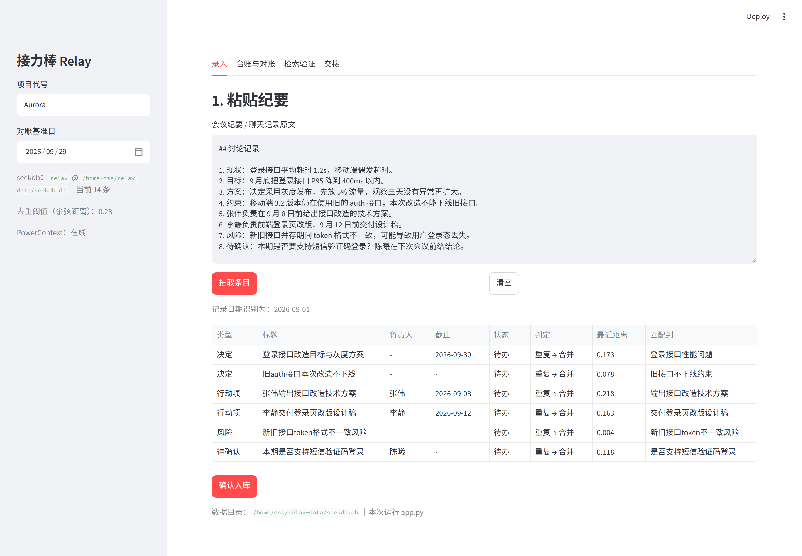
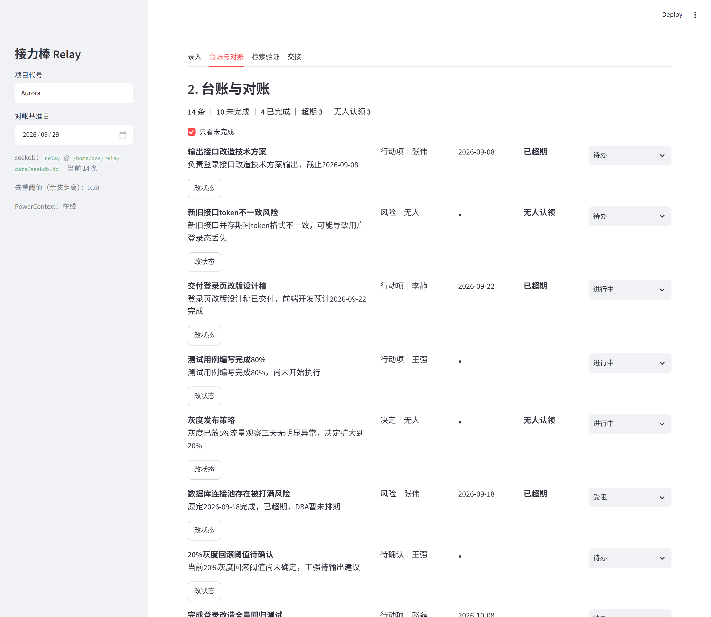
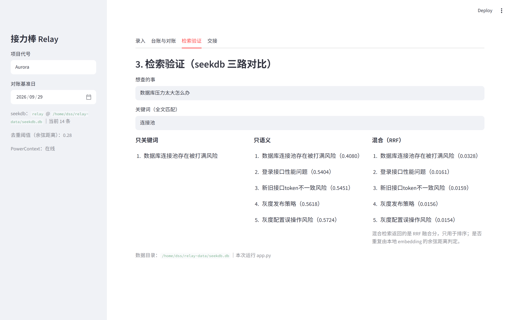
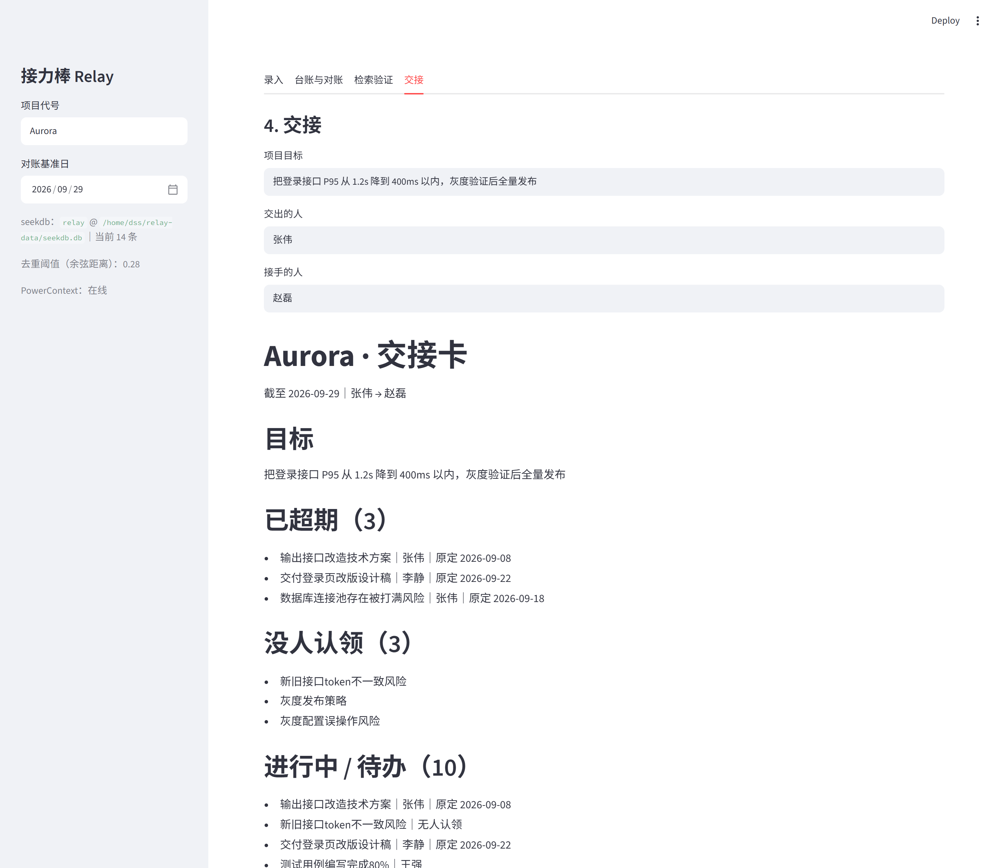
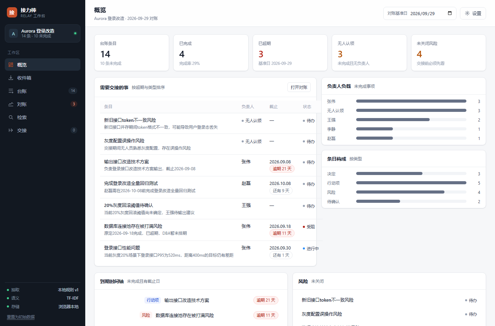

# 接力棒 Relay · 项目说明

2026 OceanBase 数据库大赛 · Qoder 赛道参赛项目。

作品是一个可以直接操作的工作台（`site/`），不是介绍页。本文档承载原展示站上的全部说明性内容：项目背景、技术选型、实测数据、界面说明、复现方式与边界。工作台上出现的每一个数字，都能在 `evidence/` 的运行日志或 `site/data/` 的种子数据里找到对应行。

---

## 1. 项目定位

**用一句话说**：把会议纪要、聊天记录、散落的待办，变成一张**可确认、可对账、可交接**的任务台账。

**使用者**：项目负责人、要接手别人工作的工程师、需要向上汇报进度的 Tech Lead。

**交付形态**：

| 部分 | 位置 | 作用 |
| --- | --- | --- |
| 工作台（静态 SPA） | `site/` | 抽取、判重、台账、对账、检索验证、交接，全部可操作 |
| 真实链路（后端） | `app.py`、`backend/` | StepFun 抽取 → seekdb 混合检索去重 → 台账对账 → PowerContext 交接 |
| 实测日志 | `evidence/` | 四条链路的原始输出，判题用 |
| 种子数据 | `site/data/*.json` | 由 `scripts/export_site_data.py` 从 seekdb 台账与三份纪要导出 |

工作台是一个**可离线的完整副本**：台账、判重、对账、交接都在浏览器里跑，刷新不丢，换一台机器回到初始的 14 条台账。后端链路保留真实模型、真实向量库与 PowerContext 的完整实现与日志，两者共享同一套数据模型与判定形状。

---

## 2. 解决什么问题

同一件事在启动会、周会、交接会里被说了三遍，措辞每次不同；人一调走，当时的决定和约束留在聊天记录里；没有基准日，就没人发现「原定 9 月 18 日联系 DBA」已经超期两周。

拆开是三个具体故障：

1. **进度反复确认**：「登录接口 P95 还没到 400ms」散落在三份纪要里。人工对齐只能通读聊天记录，读一遍就过时。
2. **交接靠嘴**：「旧 auth 接口不能下线，因为移动端 3.2 还在用」只存在于历史消息。接手人不知道这条约束，一旦下线就是事故。
3. **超期与失联没人管**：任务没有统一台账、没有基准日，超期与无人认领不会被任何流程发现。

对应到系统里的三个动作：**去重合并**（同一件事只留一条最新状态）、**按基准日对账**（超期 / 无人认领 / 受阻 / 待确认）、**带快照的交接**（接手人看到生成那一刻的台账，而不是会议印象）。

---

## 3. 核心链路

```
粘贴纪要
  → StepFun 抽取（决定 / 行动项 / 风险 / 待确认，带负责人、截止日、状态）
  → seekdb 混合检索召回候选（全文 + 向量 + 标量过滤，RRF 融合）
  → 余弦距离复核：同一件事则合并更新，不同才新增
  → 台账
  → 对账（基准日算超期，负责人算失联）
  → PowerContext 交接（工作契约 → Prepared Handoff → 确认回执 → 任务结果）
```

工作台里对应六个视图：概览、收件箱、台账、对账、检索、交接。

---

## 4. 初始台账与数字口径

种子台账 14 条，截至基准日 **2026-09-29**：

| 指标 | 数值 | 口径 |
| --- | --- | --- |
| 台账条目 | 14 | 三份纪要抽取并去重后的结果 |
| 已完成 | 4 | `status = done` |
| 未完成 | 10 | 待办 + 进行中 + 受阻 |
| 已超期 | 3 | 未完成且 `due < 基准日` |
| 无人认领 | 3 | 未完成且没有负责人 |
| 未关闭风险 | 4 | `kind = risk` 且未完成 |
| 受阻 | 1 | `status = blocked` |
| 待确认（未关闭） | 1 | `kind = question` 且未完成 |

基准确认日是工作台右上角的「对账基准日」。改这个日期，超期、逾期天数、交接卡里的「已超期」会一起变——这是系统里唯一的时间开关。

三份纪要原文在 `data/samples/`，导出的 JSON 在 `site/data/`。抽取条数会随模型输出小幅浮动（evidence 那次是 23 抽 → 14 条台账），但合并/新增的判定和台账结构不变。

---

## 5. 为什么这里必须是 seekdb

判断「这条是不是上次那件事」，**只靠关键词会漏**，**只靠语义会错**。所以一次 `hybrid_search` 同时用三路：

- **全文**：保证「连接池」「灰度」这类精确词不漏；
- **向量**：换了说法也能命中同一件事（「数据库压力大」↔「连接池打满」）；
- **标量过滤**：只在同一个项目、未完成的任务里比，避免跨项目误合并。

台账 14 条上的实测对比（完整输出见 `evidence/02-retrieval-on-ledger.log`）：

| 查询 | 只关键词 | 只语义 | 混合 RRF |
| --- | --- | --- | --- |
| `连接池` / `数据库压力太大怎么办` | 命中 1 条（精确） | 命中 5 条，其中 4 条无关 | 目标条目排第 1，后 4 条按 RRF 分递减 |

只关键词的问题在另一侧：换成「库压得太狠了」就一条都命中不了。只语义会把「灰度配置误操作风险」也带回来，因为它们在向量空间里近。混合检索把两路的排序融合，目标条目稳定在前，无关项只是陪跑。

**namespace 与标量过滤**：同一套库承载多项目，查询时带 `{"project": "Aurora"}` 与 `{"status": {"$in": [...]}}`，去重只在同项目、未完成的任务里比。

**嵌入式跑在 WSL**：seekdb 没有 Windows 原生包，用 `pyseekdb` 嵌入式实例，数据目录放 WSL 文件系统，避开 `/mnt/c` 的文件锁；`.env` 里填了 `SEEKDB_HOST/PORT` 就切换成 server 模式。

---

## 6. 去重阈值是量出来的

RRF 分只用于排序，不能当相似度。流程是「混合检索召回候选 → 用余弦距离复核」。

**后端真实链路**（bge-small-zh-v1.5，512 维）：三份纪要跑下来，距离分成两簇，中间是空的。合并一簇最大 **0.238**，新增一簇最小 **0.289**，阈值取 **0.28**。校准阶段试过 0.45 与默认 0.62：三份纪要会被压成个位数条目，整个项目塌成一条任务，超期与失联全部归零——这是本项目里唯一一处「模型看起来在工作、其实全错」的地方。

逐条判定（节选自 `evidence/03-demo-e2e.log`）：

| 判定 | 条目对 | 余弦距离 |
| --- | --- | --- |
| 同一件事 | 给出 20% 灰度回滚阈值建议 ↔ 20%灰度回滚阈值待确认 | 0.047 |
| 同一件事 | 登录页改版设计稿已交付 ↔ 交付登录页改版设计稿 | 0.062 |
| 同一件事 | 旧 auth 接口暂不下线 ↔ 旧接口不下线约束 | 0.073 |
| 同一件事 | 灰度流量从 5% 扩大至 20% ↔ 灰度发布策略 | 0.129 |
| 同一件事 | 登录接口改造方案评审通过 ↔ 登录接口性能问题 | 0.238 |
| 不同任务 | 交付登录页改版设计稿 ↔ 输出接口改造技术方案 | 0.289 |
| 不同任务 | 完成登录改造三项前置工作 ↔ 输出接口改造技术方案 | 0.312 |
| 不同任务 | 灰度配置误操作风险 ↔ 灰度发布策略 | 0.329 |
| 不同任务 | 新旧接口 token 不一致风险 ↔ 旧接口不下线约束 | 0.355 |
| 不同任务 | 是否支持短信验证码登录 ↔ 新旧接口 token 不一致风险 | 0.495 |

**工作台里的轻量引擎**：没有 512 维向量模型，用「字符二元组 + TF-IDF + 余弦」实现同一套判定形状。在同一批数据上重新校准，阈值取 **0.55**：合并簇最大距离 0.515，新增簇最小距离 0.603。工作台的「判重阈值」滑块就是这个值，改完对下一次抽取生效；抽出来的每条都能看到距离与命中的历史条目，并且可以手动把「合并 / 新增」翻过来——判定结果可审计，也可推翻。

两套阈值不能互抄：向量模型不同，距离尺度就不同。工作台右侧状态栏明确写着当前用的是「本地规则 v1 + TF-IDF」。

---

## 7. 为什么这里必须是 PowerContext

台账解决「现在有哪些事」，解决不了「为什么这么定」。约束必须活得比单次会话久，交接必须可确认——不能是「我口头交代过了」。

PowerContext 侧分两层使用：

- **Source**：三份纪要原文落库，条目可回溯到原文；
- **Memory**：决定与约束写成 atomic-memory，交接时按需召回。

交接动作固定四步，每一步在同一个 Scope 内占一个单调递增的 `position`：

| 步骤 | 内容 | evidence 里的 position |
| --- | --- | --- |
| 工作契约 | 目标、在范围、排除项、完成标准、未确认问题 | 44 |
| Prepared Handoff | 当前状态 + 下一步，逐条带证据引用 | 45 |
| 确认回执 | 接手人自检现场 / 能力 / 授权后 accept，证据状态 `available` | 46 |
| 任务结果 | 本轮结果与剩余工作落库 | 47 |

交接时 `/v1/context/prepare` 召回的上下文（2036 字节，节选自 `evidence/04-powercontext-setup.log`）：

> 旧接口不下线约束：因移动端3.2版本仍在使用旧auth接口，该接口暂不能下线
> 登录接口P95性能目标：当前20%灰度下登录接口P95为520ms，距离400ms的目标仍有差距

每条都带 `artifact_id + revision` 引用，可回溯原文；接手人不必重读三次纪要。

**边界**：本地没有给 PowerContext 配推理模型，`memory/search` 走的是 `mode=text` 的词面召回，配上 embedding 后会切到语义模式。这一点在旧版侧栏与本文档里都如实标注。

**工作台的交接**：不依赖 PowerContext Server。点「生成交接」时把当前台账做成快照，四步各记一个本地 `position`（1、2、3、4 递增），交接卡与记录都落在浏览器本地，可以打开、复制、导出。它复刻的是「四步 + 快照 + 递增位置」这套约束，不是 PowerContext 服务本身。

---

## 8. 工作台怎么用

打开作品链接（或本地 `site/index.html`），得到的是「Aurora 登录改造」项目的台账。

**概览** — 五块 KPI（条目、已完成、已超期、无人认领、未关闭风险）、按紧急度排序的「需要交接的事」、负责人负载、类型构成、到期时间轴、未关闭风险。点任意条目打开详情抽屉。

**收件箱** — 三份样例纪要一键载入，也可以「自定义粘贴」。点「抽取条目」，右侧列出每条候选：类型、标题、负责人、截止、状态、判定（新增 / 合并）、余弦距离、命中的历史条目。可以逐条勾选、批量「全选 / 清空 / 只选新增 / 只选合并」，点「写入台账」后新增与合并分别记账。把 `meeting-01` 再抽一次，8 条会全部判为合并——重复录入不会把台账撑大。

**台账** — 按类型、状态、超期、无人认领筛选，搜索标题/详情/负责人；表格内直接改状态，点行打开抽屉改负责人、详情、截止日；可新增、删除、导出 JSON。

**对账** — 超期、无人认领、受阻、待确认四张清单，类型 × 状态矩阵，负责人负载；「生成对账报告」就地预览 Markdown，可复制、可下载，直接作为交接附件。

**检索** — 关键词、语义、混合三路并排。预设查询覆盖四个典型问法；「排序解释」给出前三名的关键词命中、余弦相似度、两路名次与 RRF 分，以及查询的词元切分。点任意结果打开同一条目。

**交接** — 填目标与交出/接手人；三项核对（看过实时台账、能力对得上、授权已确认）全部勾选后按钮才可用；生成后右侧出现交接记录，点开是四步时间线 + 交接卡 Markdown，可复制。

所有状态存在浏览器 `localStorage`（键 `relay.workbench.v2`）。设置里可以调阈值、导出全部状态、重置为初始 14 条。

---

## 9. 实测截图

截图时间为 2026-09-29，对应台账 14 条、超期 3、无人认领 3。图片在 `site/assets/`，来自真实运行，不是设计稿。



*录入：把已经入库过的 meeting-01 再贴一次，8 条全部判为「重复 → 合并」，每条带最近距离与命中的旧条目。*



*台账与对账：14 条 ｜ 10 未完成 ｜ 超期 3 ｜ 无人认领 3。*



*检索验证：三路结果并排，给评委直接验证 seekdb 的必要性。*



*交接：一张能直接发给接手人的卡片，四步各占一个 position。*



*工作台概览（静态站，本地数据）。*

---

## 10. 复现

环境：Windows + WSL2 (Ubuntu)。seekdb 没有 Windows 原生包，数据库跑在 WSL 里；代码放 Windows 侧，通过 `/mnt/c` 访问。

- Python 3.12（WSL 内 `~/relay-venv`）
- seekdb 嵌入式：`pyseekdb` + `pylibseekdb`；`.env` 填 `SEEKDB_HOST/PORT` 即切 server 模式
- 对话模型：StepFun `step-3.5-flash`（无 embedding 接口）
- Embedding：`fastembed` + `BAAI/bge-small-zh-v1.5`（ONNX，不装 torch），下载走 `hf-mirror.com`
- PowerContext：独立 venv（`~/pc-venv`），`powercontext[cli,server]==1.4.1`，SQLite 存储

```bash
# 1) WSL 起 PowerContext Server（一次性）
python3.12 -m venv ~/pc-venv && ~/pc-venv/bin/pip install "powercontext[cli,server]==1.4.1"
mkdir -p ~/pc-run && cd ~/pc-run && ~/pc-venv/bin/powercontext config init --template -o .env <<< y
cd ~/pc-run && nohup ~/pc-venv/bin/powercontext server run > server.log 2>&1 &

# 2) Windows 侧，项目根目录
bash run.sh scripts/smoke_embed.py          # embedding 维度与距离分布
bash run.sh scripts/smoke_seekdb.py         # seekdb 三种检索方式对比
bash run.sh scripts/smoke_llm.py            # StepFun 结构化抽取
bash run.sh scripts/setup_powercontext.py   # 建 Scope、纪要落 Source、决定落 Memory、验证召回
bash run.sh scripts/demo_e2e.py --reset     # 端到端：纪要 → 去重 → 台账 → 对账 → 交接四步
bash run.sh scripts/retrieval_check.py      # 真实台账上的三路检索对比
```

### 工作台 / 静态站

```bash
# 从 seekdb 导出种子数据（WSL 内执行，台账 14 条 / 纪要 3 份）
bash run.sh scripts/export_site_data.py

# 本地预览
cd site && python3 -m http.server 8777 --bind 127.0.0.1
# 打开 http://127.0.0.1:8777/
```

工作台是纯静态 ES 模块，无构建步骤。直接双击 `index.html` 会因 `fetch` 受 `file://` 限制而起不来，用任意静态服务器即可。

发布走 Qoder Sites：`prepare_site(projectRoot=<repo>, webDirectory="site")` 会生成 `.站点名称.qoder.site` 描述文件。这个文件由工具生成，不要手写或修改。

### 桌面版 Streamlit（后端链路）

```bash
bash run.sh --ui        # http://localhost:8501
```

四个页签：录入（StepFun 抽取 + 逐条判重）、台账与对账、检索验证（三路并排）、交接（交接卡 + PowerContext 四步）。

---

## 11. 边界与诚实说明

- **工作台的抽取是规则引擎**：按类型词、状态词、负责人、日期、句式切分，覆盖样例纪要的写法，不做语义理解。后端用 StepFun，条目数会小幅浮动。两者共享台账结构与「合并/新增」判定形状。
- **工作台不连接 seekdb**：静态站无法开数据库连接，语义检索用字符二元组 TF-IDF 复刻三路对比的结构；真实向量检索结果见 `evidence/02-retrieval-on-ledger.log`。
- **工作台不连接 PowerContext**：四步与 position 在本地模拟并持久化，真实服务行为与召回见 `evidence/03`、`04`。
- **数据只在浏览器**：`localStorage` 键 `relay.workbench.v2`。换浏览器、清缓存、点「重置为初始数据」都会回到 14 条种子台账。
- **单项目**：工作台固定为「Aurora 登录改造」。多项目 namespace 在后端链路里实现（`project` 标量过滤），工作台未做项目切换。
- **数字口径**：页面数字来自当前台账与基准日，不是写死的。截图与本文数字对应 2026-09-29 的 14 条台账；如果你在页面上先录入再截图，数字会不同。

---

## 12. 证据索引

| 文件 | 内容 |
| --- | --- |
| `evidence/01-seekdb-smoke.log` | seekdb 三种检索方式与建库验收 |
| `evidence/02-retrieval-on-ledger.log` | 真实台账上的三路检索对比 |
| `evidence/03-demo-e2e.log` | 端到端逐条判定、台账、交接卡与 position |
| `evidence/04-powercontext-setup.log` | Scope 建立、Memory 写入、交接上下文召回 |
| `data/out/handoff-card.md` | 生成的交接卡原文 |
| `data/out/search-check.txt` | 检索核对输出 |
| `data/out/recall-check.txt` | 召回核对输出 |
| `site/data/ledger.json` | 工作台种子台账（14 条） |
| `site/data/meetings.json` | 工作台三份样例纪要 |
| `site/assets/ui-*.png` | 真实运行截图（2026-09-29） |
